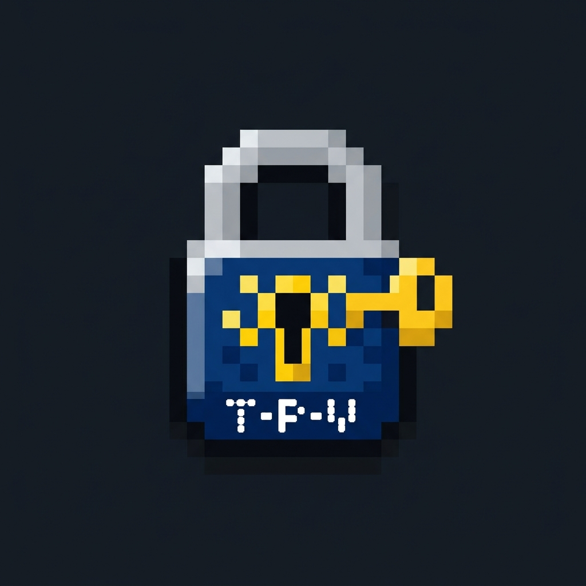

# Tray Password Vault



A password manager for Windows 11 that lives in the system tray and uses KeePass
(`.kdbx`) files. Download `TrayPasswordVault.zip` from Releases and run the exe.

Website: https://wojtekadams.github.io/Tray-Password-Valut/

## Usage

On first run, pick or create a database. The app starts with Windows and asks for the
password once. The shortcut (`Win+W` by default, changeable in the tray menu) opens
the popup.

| Input | Action |
| --- | --- |
| Typing | Search |
| Click password, Enter | Copy password (cleared from clipboard after 30 s) |
| Click login, Ctrl+U | Copy login |
| Ctrl+N, **+** | Add entry |
| Esc | Hide |

## Notes

- Supports KDBX 3.1–4.1. Key files and hardware keys are not supported.
- Saving keeps a backup as `<database>.kdbx.bak`.
- The vault locks when the screen locks or the system sleeps.
- The exe is not signed, so SmartScreen may warn on first launch.

## Building

```sh
go install github.com/tc-hib/go-winres@v0.3.3
go-winres make --arch amd64 --out cmd/traypasswordvault/rsrc
GOOS=windows GOARCH=amd64 CGO_ENABLED=0 go build -trimpath -ldflags "-H=windowsgui -s -w" -o TrayPasswordVault.exe ./cmd/traypasswordvault
```

## License

[MIT](LICENSE)
